[English](README.md)

<div align="center">

## ZaneyOS 🟰 Best ❄️ NixOS Configs

\*\* Updated: August 7th, 2026

| Note: As of release v2.6.4+ Hyprland config files are in LUA format

ZaneyOS is a simple way of reproducing my configuration on any NixOS system.
This includes the wallpaper, scripts, applications, config files, and more.

## Important Note on Noctalia

> The first time you login, screen will be blank SUPER + SHIFT + C to exit.
> Login in, noctalia will start from then on

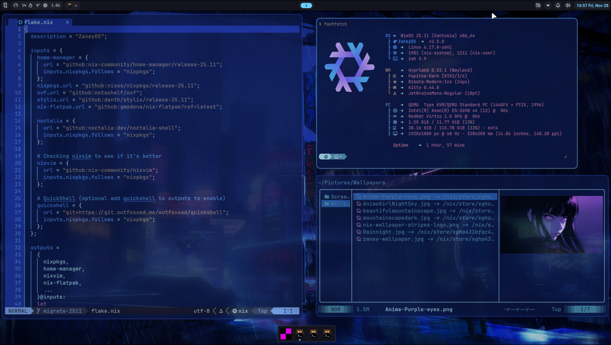

</div>

<details>
<summary><strong>📸 More Screenshots</strong></summary>

### Waybar Themes

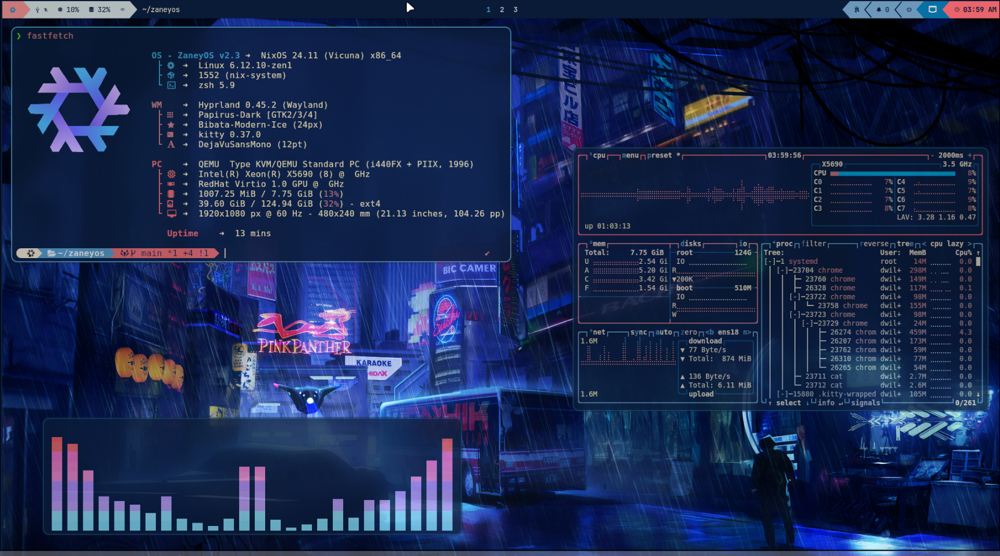

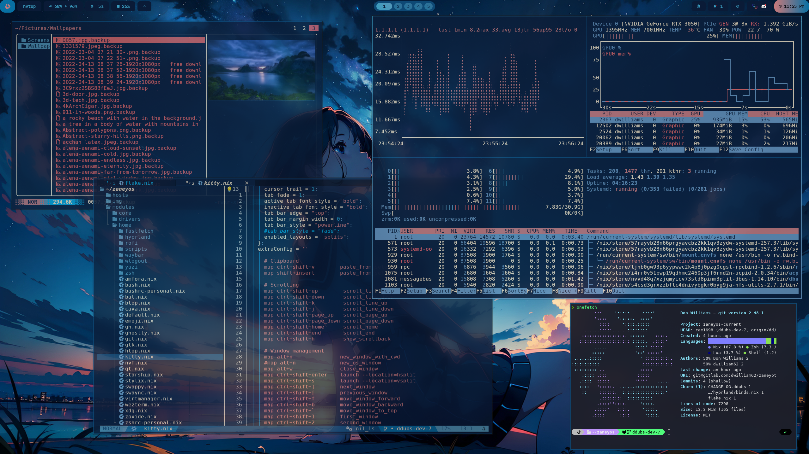

### Noctalia Shell Integration

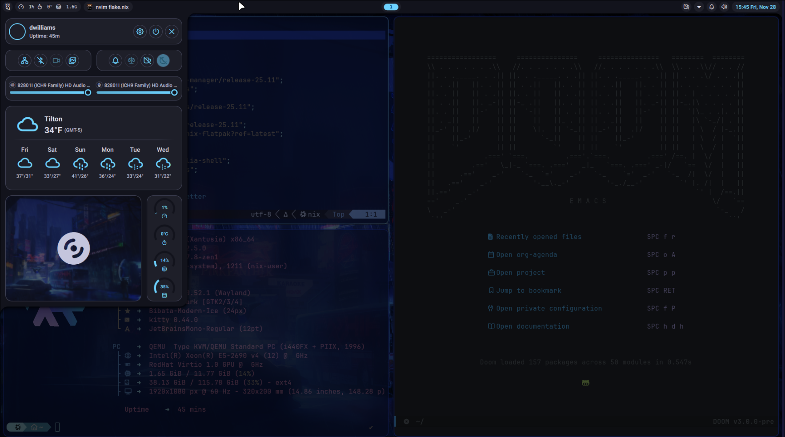

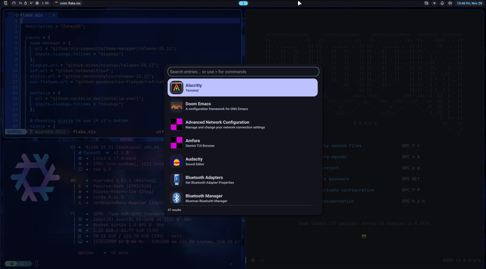

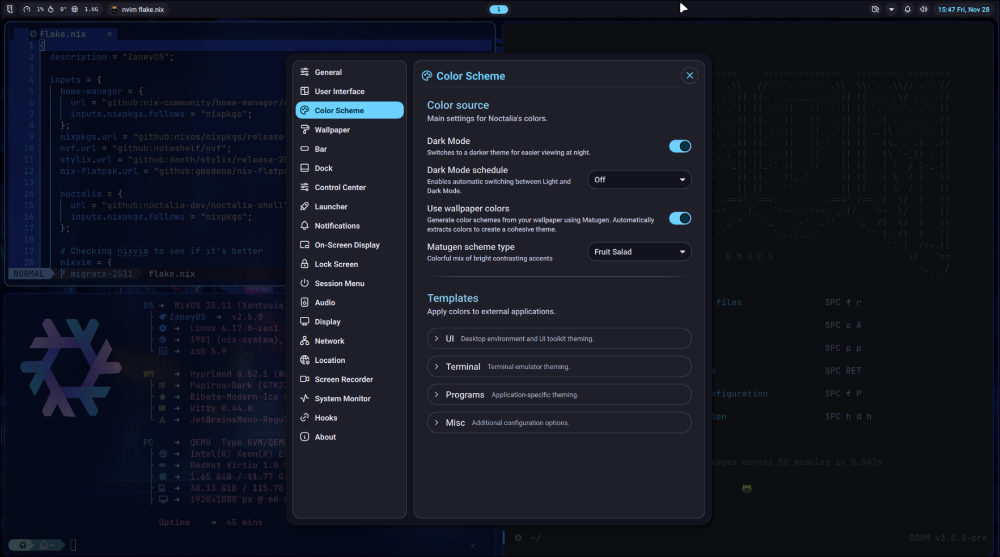

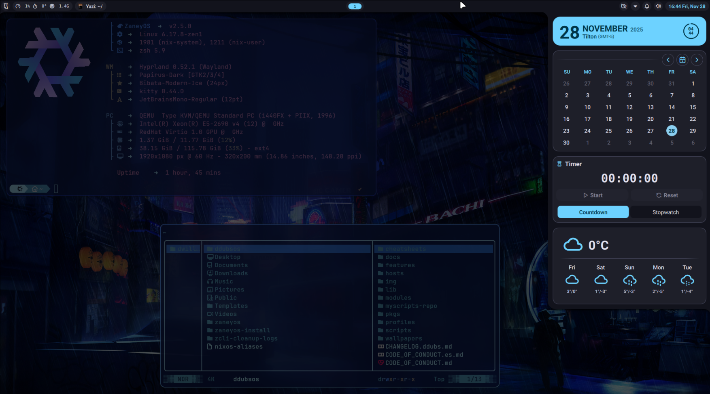

### Additional Features

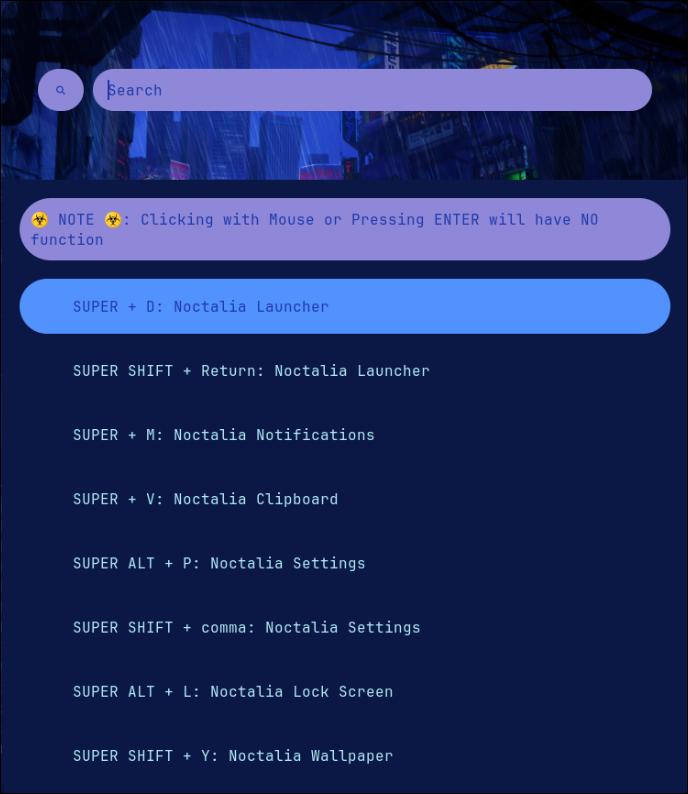

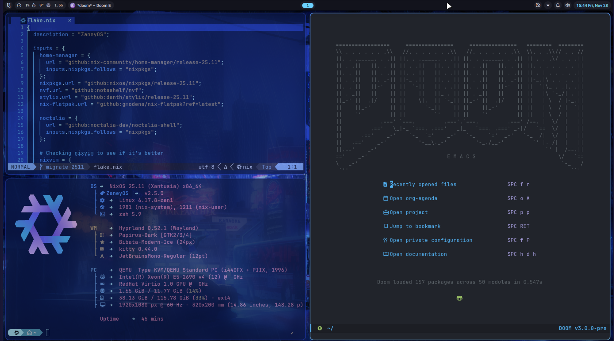

</details>

<div align="center">

### Cheatsheets and Guides

- Nix Beginner Guide: [English](cheatsheets/nix-beginner-guide.md) |
  [Español](cheatsheets/nix-beginner-guide.es.md)
- Hyprland Customization Guide:
  [English](cheatsheets/hyprland-customization-guide.md) |
  [Español](cheatsheets/hyprland-customization-guide.es.md)

#### 🍖 Requirements

- You must be running on NixOS, version 24.05+.
- The `nixos` repository folder is located in your home directory (`~/nixos`). A `~/zaneyos` symlink is automatically created for backward compatibility.
- You must have installed NIXOS using **GPT** parition with booting with
  **UEFI**.
- ** 500MB minimum /boot partition required. **
- Systemd-boot is what is supported.
- For GRUB you will have to brave the internet for a how-to. ☺️
- Manually editing your host specific files.
- The host is the specific computer your installing on.

#### 🎹 Pipewire & Notification Menu Controls

- We are using the latest and greatest audio solution for Linux. Not to mention
  you will have media and volume controls in the notification center available
  in the top bar.

#### 🏇 Optimized Workflow & Simple Yet Elegant Neovim

- Using Hyprland for increased elegance, functionality, and efficiency.
- No massive NeoVIM project here, using `nixvim` for an
  incredible NeoVIM setup. With language support already added in.

#### 🖥️ Multi Host & User Configuration

- You can define separate settings for different host machines and users.
- Easily specify extra packages for your users in the `modules/core/user.nix`
  file.
- Easy to understand file structure and simple, but encompassing, configuration.

#### 👼 An Incredible Community Focused On Support

- The entire idea of ZaneyOS is to make NixOS an approachable space.
- NixOS is actually a great community that you will want to be a part of.
- Many people who are patient and happy to spend their free time helping you are
  running ZaneyOS.
- Feel free to reach out on the Discord for any help with anything.

#### 📦 How To Install Packages?

- You can search the [Nix Packages](https://search.nixos.org/packages?) &
  [Options](https://search.nixos.org/options?) pages for what a package may be
  named or if it has options available that take care of configuration hurdles
  you may face.
- To add a package there are the sections for it in `modules/core/packages.nix`
  and `modules/core/user.nix`. One is for programs available system wide and the
  other for your users environment only.

#### 🙋 Having Issues / Questions?

- Please feel free to raise an issue on the repo, please label a feature request
  with the title beginning with [feature request], thank you!
- Contact us on [Discord](https://discord.gg/XhZmNTnhtp) as well, for a potentially
  faster response.

# Hyprland Keybindings

Below are the keybindings for Hyprland, formatted for easy reference. The right
column shows keybindings that are specific to **Noctalia Shell** (only available
when `barChoice = "noctalia"`).

<table>
<tr>
<td width="50%">

## Standard Keybindings

### Application Launching

- `$modifier + Return` → Launch `terminal`
- `$modifier + Tab` → Toggle `Quickshell Overview` (workspace overview with live previews)
- `$modifier + K` → List keybinds
- `$modifier + Shift + W` → Open `web-search`
- `$modifier + Alt + W` → Open `wallsetter`
- `$modifier + Shift + N` → Run `swaync-client -rs`
- `$modifier + W` → Launch `Web Browser`
- `$modifier + Y` → Open `kitty` with `yazi`
- `$modifier + E` → Open `emopicker9000`
- `$modifier + S` → Take a screenshot
- `$modifier + Shift + D` → Open `Discord`
- `$modifier + O` → Launch `OBS Studio`
- `$modifier + Alt + C` → Color Picker
- `$modifier + G` → Open `GIMP`
- `$modifier + T` → Toggle terminal with `pypr`
- `$modifier + Alt + M` → Open `pavucontrol`

### Window Management

- `$modifier + Q` → Kill active window
- `$modifier + P` → Toggle pseudo tiling
- `$modifier + Shift + I` → Toggle split mode
- `$modifier + F` → Toggle fullscreen
- `$modifier + Shift + F` → Toggle floating mode
- `$modifier + Alt + F` → Float all windows
- `$modifier + Shift + C` → Exit Hyprland

### Window Movement

- `$modifier + Shift + ← / → / ↑ / ↓` → Move left/right/up/down
- `$modifier + Shift + H / L / K / J` → Move left/right/up/down
- `$modifier + Alt + ← / → / ↑ / ↓` → Swap left/right/up/down

### Focus Movement

- `$modifier + ← / → / ↑ / ↓` → Move focus left/right/up/down
- `$modifier + H / L / K / J` → Move focus left/right/up/down

### Workspaces

- `$modifier + 1-10` → Switch to workspace 1-10
- `$modifier + Shift + Space` → Move window to special workspace
- `$modifier + Space` → Toggle special workspace
- `$modifier + Shift + 1-10` → Move window to workspace 1-10
- `$modifier + Control + → / ←` → Switch workspace forward/backward

### Window Cycling

- `Alt + Tab` → Cycle to next window / Bring active to top

</td>
<td width="50%">

## 🎨 Noctalia Shell Keybindings

_Available when `barChoice = "noctalia"` in `variables.nix`_

- `$modifier + D` → Launcher Toggle
- `$modifier + Shift + Return` → Launcher Toggle
- `$modifier + M` → Notifications Menu
- `$modifier + V` → Clipboard Manager
- `$modifier + Alt + P` → Settings Panel
- `$modifier + Shift + ,` → Settings Panel
- `$modifier + Alt + L` → Lock Screen
- `$modifier + Shift + Y` → Wallpaper Manager
- `$modifier + X` → Power Menu
- `$modifier + C` → Control Center
- `$modifier + Ctrl + R` → Screen Recorder

### Rofi Launcher (Waybar Mode)

_Available when `barChoice = "waybar"` in `variables.nix`_

- `$modifier + D` → Launch Rofi Launcher
- `$modifier + Shift + Return` → Launch Rofi Launcher

### Other Features

- `$modifier + Shift + Return` (Waybar) → Application Launcher
- `$modifier + V` (Waybar) → Clipboard History via `cliphist`

</td>
</tr>
</table>

## Installation:

> **⚠️ IMPORTANT:** This installation script is designed for a **post-installation setup on an existing NixOS system** (version 24.05+ with UEFI & systemd-boot). Run this from your normal user account after booting into your fresh NixOS install — **do not run this from a live installer USB**.

<details>
<summary><strong> ⬇️ Install with script (NEW INSTALLATIONS ONLY)</strong></summary>

### 📜 Script:

This is the easiest and recommended way of starting out for **new
installations**. The script is not meant to allow you to change every option
that you can in the flake or help you install extra packages. It is simply here
so you can get my configuration installed with as little chances of breakages
and then fiddle to your hearts content!

> **⚠️ WARNING:** This script will replace any existing ~/nixos directory. If
> found, a backup of your previous configuration is saved to
> ~/.config/nixos-backups/.

Simply copy this and run it:

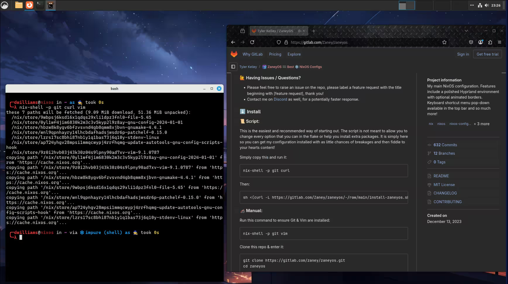

```
nix-shell -p git curl pciutils
```

Then run the installation script:

```bash
sh <(curl -sSL https://raw.githubusercontent.com/rahativity/nixos/main/install-nixos.sh)
```

#### The install process will look something like this:

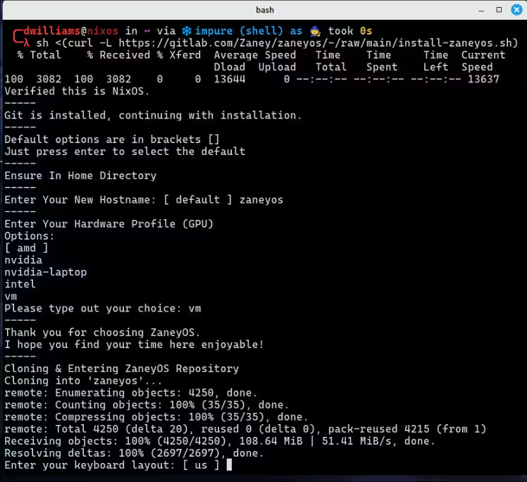

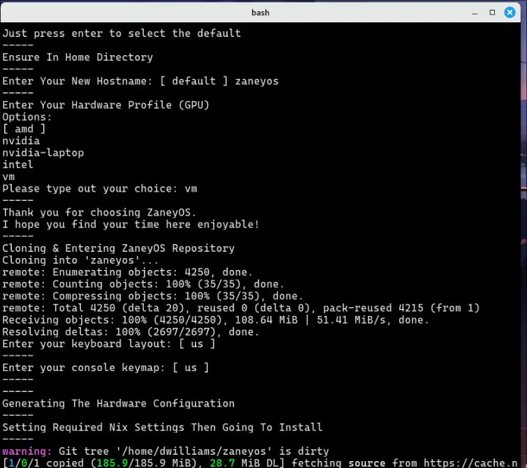

#### After the install completes your environment will probably look broken. Just reboot and you will see this as your login:

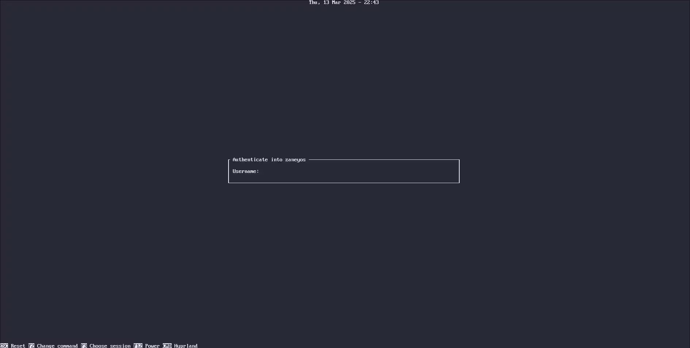

#### Then after login you should see a screen like this:

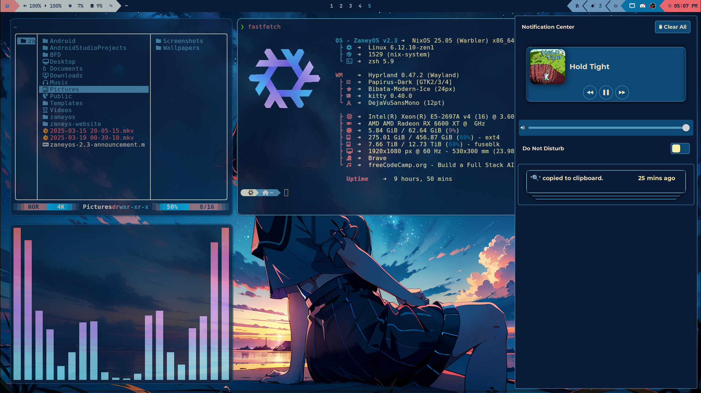

</details>

<details>
<summary><strong> 🦽 Manual install process:  </strong></summary>

1. Run this command to ensure Git & Vim are installed:

```bash
nix-shell -p git vim
```

2. Clone this repo & enter it:

```bash
git clone https://github.com/rahativity/nixos.git ~/nixos
cd ~/nixos
```

3. Create the host folder for your machine (or use an existing one like `hosts/workbook`):

```bash
cp -r hosts/default hosts/<your-desired-hostname>
nixos-generate-config --show-hardware-config > hosts/<your-desired-hostname>/hardware.nix
git add .
```

4. Edit `hosts/<your-desired-hostname>/variables.nix` with your preferences.

5. Run the rebuild to switch to your profile (`amd`, `intel`, `nvidia`, `nvidia-laptop`, `amd-nvidia-hybrid`, or `vm`):

```bash
NIX_CONFIG="experimental-features = nix-command flakes"
sudo nixos-rebuild switch --flake ~/nixos/#<profile>
```

Now when you want to rebuild the configuration, you can run `zcli rebuild` or the alias `fr`.
</details>

### Special Recognitions:

Thank you for all your assistance

- KoolDots  https://github.com/LinuxBeginnings
- JakKoolit  https://github.com/Jakoolit
- Justaguylinux https://codeberg.org/Justaguylinux
- Jerry Starke https://github.com/JerrySM64

## Hope you enjoy!
```
